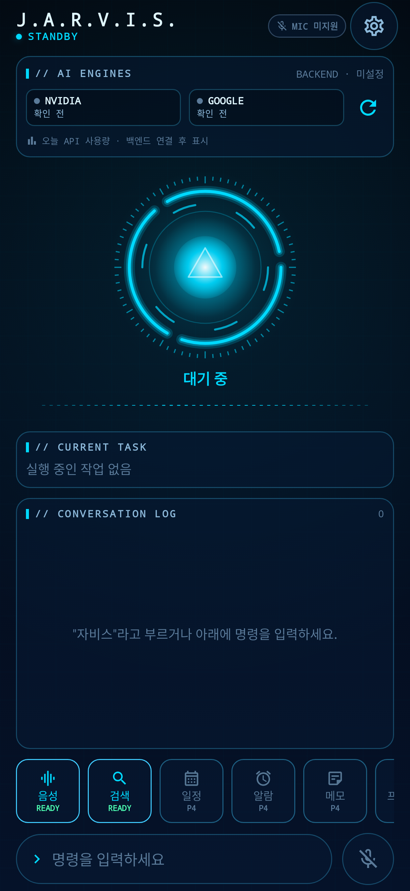
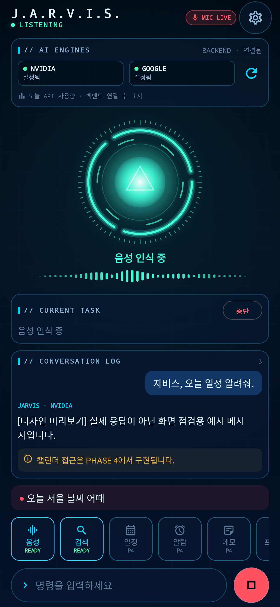
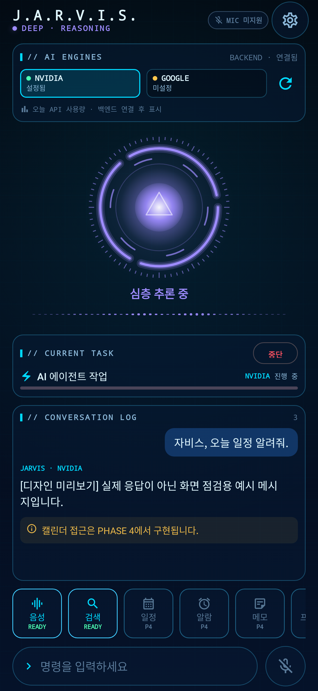
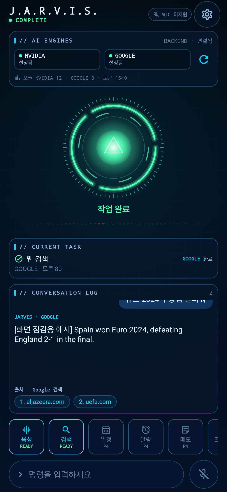
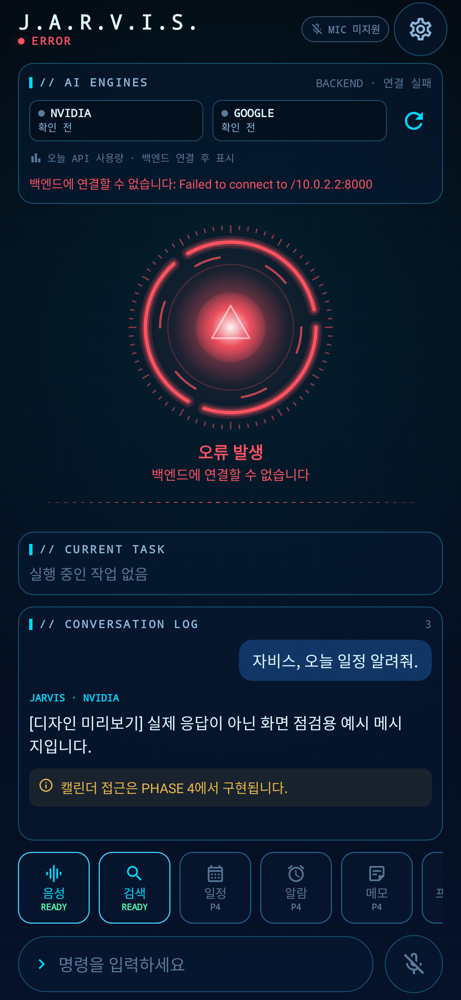
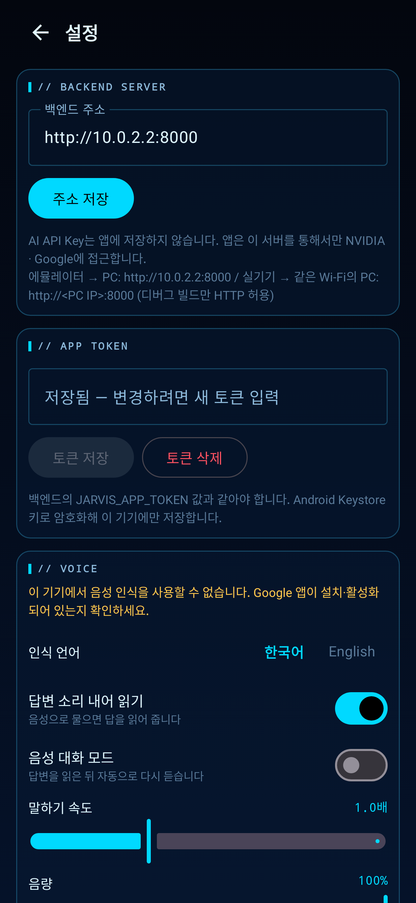

# JARVIS — Personal AI Assistant (Android)

음성으로 대화하고, 검색하고, 계획하고, 실제 기능을 실행하는 개인용 AI 비서 (Android · Kotlin · Jetpack Compose).

- 대화·에이전트: NVIDIA API Catalog · 검색·검색 분석: Google (Gemini Grounding)
- 유료 Claude API는 비용 문제로 사용하지 않습니다 (2026-11-21 결정)
- API Key는 백엔드에만 저장: `Android 앱 ↔ HTTPS 백엔드 ↔ AI 제공자`

**PC 설정 가이드: [`docs/PC_SETUP.md`](docs/PC_SETUP.md)** · 설계: [`docs/ARCHITECTURE.md`](docs/ARCHITECTURE.md) · 진행 상황: [`PROJECT_STATUS.md`](PROJECT_STATUS.md)

> 2026-11-21: 개발 PC가 Windows이므로 iOS에서 Android로 전환했습니다. 이전 iOS 코드는 `ios/`에 보관(개발 중단)되어 있습니다.

## 화면 미리보기

| 대기 | 음성 인식 중 | 심층 추론 중 | 검색 답변 + 출처 | 오류 | 설정 |
|---|---|---|---|---|---|
|  |  |  |  |  |  |

## 요청 처리

| 말하면 | 경로 | 엔진 |
|---|---|---|
| "안녕 자비스", "블랙홀이 뭐야?" | 대화 | NVIDIA |
| "오늘 서울 날씨", "최신 AI 뉴스" | 검색 | Google (Gemini Grounding) — 출처·검색 제안 표시 |
| "전기차 시장 동향 조사해서 분석해줘" | 검색 분석 | Google (Gemini Grounding) — 비교·분석 |
| "파이썬 자동화 프로젝트 기획해줘" | 에이전트 | NVIDIA 대형 추론 모델 (nemotron-3-ultra) |
| "7시에 알람 맞춰줘" | 기기 기능 | 로컬 (PHASE 4) |

**음성**: 마이크 버튼으로 말하기 · 답변 읽어 주기 · 음성 대화 모드 · **"자비스" 호출 (앱이 꺼져 있어도, 설정에서 켜기)**

(Robolectric + Roborazzi로 실제 Compose 렌더링 결과를 기록한 이미지)

## 빠른 시작 (Windows)

### 준비물
- [Android Studio](https://developer.android.com/studio) 최신 버전 (JDK·Android SDK 포함)
- Python 3.10 이상 (백엔드)
- Android 휴대폰(Android 8.0 이상) 또는 Android Studio 에뮬레이터

### 1. 백엔드 실행 (PowerShell)

```powershell
cd backend
py -m venv .venv
.venv\Scripts\Activate.ps1      # 실행 정책 오류 시: Set-ExecutionPolicy -Scope CurrentUser RemoteSigned
pip install -r requirements-dev.txt
copy .env.example .env          # 메모장으로 열어 JARVIS_APP_TOKEN 입력
pytest
uvicorn app.main:app --reload --env-file .env --host 0.0.0.0 --port 8000
```

확인: 브라우저에서 `http://localhost:8000/health`

실제 AI API 연결 점검 (키 입력 후, 비용 소량 발생):

```powershell
python -m scripts.live_check            # nvidia(대화) / agent(에이전트) / google(검색) 각각 짧은 요청
```

### 2. 앱 실행

1. Android Studio → **Open** → `android` 폴더 선택 (Gradle 동기화 자동 진행)
2. 상단 기기 목록에서 에뮬레이터 또는 USB로 연결한 휴대폰 선택 → ▶ Run
   - 휴대폰: 설정 → 휴대전화 정보 → 빌드번호 7번 탭 → 개발자 옵션 → **USB 디버깅** 켜기
3. 앱 오른쪽 위 ⚙ → 설정
   - 백엔드 주소 — 에뮬레이터: `http://10.0.2.2:8000` / 휴대폰: 같은 Wi-Fi에서 `http://<PC IP>:8000`
     (PC IP 확인: PowerShell `ipconfig` → IPv4 주소. Windows 방화벽에서 8000 포트 허용 필요)
   - 앱 인증 토큰 — `.env`의 `JARVIS_APP_TOKEN` 값
   - **연결 테스트** → "연결됨"

### 3. 테스트 (명령줄)

```powershell
cd android
.\gradlew.bat :core:test :app:testDebugUnitTest      # 단위 테스트
.\gradlew.bat :app:recordRoborazziDebug             # 화면 스냅샷 갱신 → app/screenshots/
.\gradlew.bat :app:assembleDebug                    # APK → app/build/outputs/apk/debug/
```
